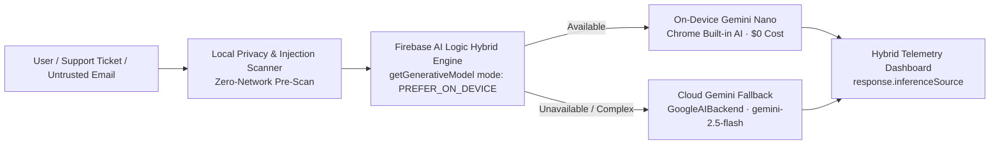

# 🛡️ ShieldMesh Hybrid AI

**A Local-First Privacy & Prompt-Injection Firewall powered by Firebase AI Logic Hybrid Inference SDK (`firebase/ai` v12.5+): on-device Chrome Gemini Nano first, with seamless cloud Gemini fallback.**

Built for **Google [#BuildHybridAI 2026](https://firebasehybridaihackathon.devpost.com/)**.

---

## ✨ Why Hybrid AI Is Essential Here

Sensitive enterprise workflows face a classic AI dilemma:
- **Customer tickets & internal notes** contain PII (emails, phone numbers, payment cards, leaked tokens) that should stay **on-device** (`ON_DEVICE`) for privacy, zero latency, and \$0 API cost.
- **Complex multi-regulation compliance & deep threat analysis** — or users on browsers/devices without Gemini Nano — still need reliable **cloud fallback** (`IN_CLOUD`).

**ShieldMesh Hybrid AI** solves both in one unified web workspace using **Firebase AI Logic Hybrid Inference**:
1. **Real-Time 4-Mode `InferenceMode` Switching**:
   - `InferenceMode.PREFER_ON_DEVICE` — Runs on Chrome's built-in Gemini Nano when available; seamlessly falls back to Cloud Gemini via `GoogleAIBackend`.
   - `InferenceMode.ONLY_ON_DEVICE` — Enforces strict zero-egress privacy; blocks cloud calls if local Gemini Nano is unavailable.
   - `InferenceMode.PREFER_IN_CLOUD` — Uses Cloud Gemini first, gracefully falling back to on-device when offline.
   - `InferenceMode.ONLY_IN_CLOUD` — Forces cloud-hosted Gemini reasoning.
2. **Local Privacy Shield (Pre-Cloud Redaction)**:
   - Deterministic client-side PII redaction (email, phone, card numbers, API tokens) and indirect prompt-injection pre-scanning run **before** any fallback payload reaches the cloud.
3. **Live `response.inferenceSource` Telemetry Dashboard**:
   - Tracks `ON_DEVICE` vs `IN_CLOUD` execution ratio, average latency, estimated cloud tokens saved, and a live routing trace log exportable as JSON.
4. **Zero-Friction Testing & Browser-Local Firebase Config**:
   - Works out-of-the-box with Chrome Built-in AI or Zero-Key Preview Mode, and switches to live **Firebase AI Logic SDK (`v12.5.0`)** in seconds when you paste your Firebase Web Config in **⚙️ Firebase Config** (stored strictly in browser `localStorage`).

---

## 🧩 Architecture



---

## 🚀 Run Locally (Bound to `127.0.0.1` Only)

```bash
python -m http.server 8788 --bind 127.0.0.1
# Open http://127.0.0.1:8788 in Chrome 139+
```

## ☁️ Deploy to Firebase Hosting

```bash
firebase init hosting   # select existing project, public dir "."
firebase deploy --only hosting
```

## ✅ Automated Contract & Security Tests

```bash
python -m unittest discover -s tests -p "test_*.py" -v
```
